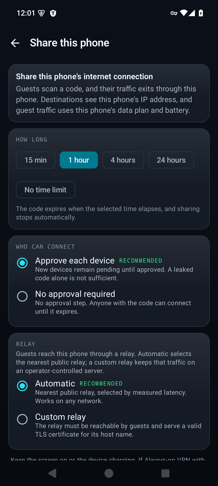
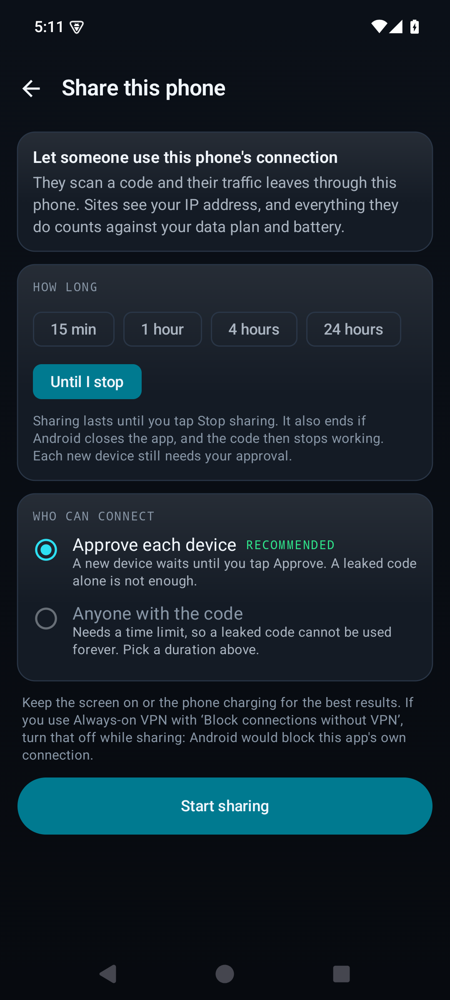
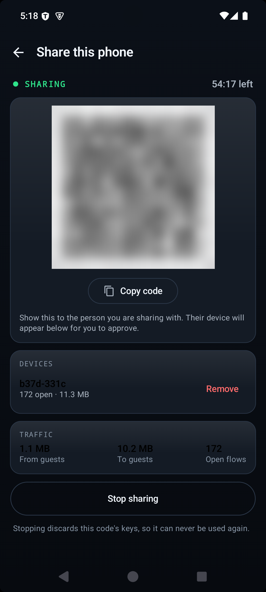

# OpenTailcat

**One Android app for both ends of a Tailcat tunnel.** As a **client**, it sends
this phone's traffic through your own
[Tailcat](https://github.com/tailscale/tailcat) exit gateway: you run the
gateway, paste its `tc…` token, and traffic leaves through it. As an **exit
node**, it does the reverse: **Share this phone** mints a one-session code and
lets another device browse through this phone's connection. No account, no
subscription, and no control plane in the middle.

Independent community project. Not affiliated with Tailscale Inc.

| Client, connected | Live tunnel benchmark |
| --- | --- |
|  |  |

## Two roles, one app

| | **Client** | **Exit node (Share this phone)** |
| --- | --- | --- |
| What it does | Sends this phone through a gateway you run | Lends this phone's connection to a guest device |
| What you need | A `tc…` token from the gateway | Nothing; the app mints a one-session code |
| Android VPN | TUN, consent dialog, Always-on support | No TUN or consent; an ordinary foreground service |
| At the same time | Never runs alongside the exit node | Never runs alongside the client |

## What you need

- **As a client:** a Tailcat-compatible **exit gateway you control** (for
  example `tailcat serve exit-node`) and the `tc…` token it prints. Or, to use
  someone's phone as the gateway, the code that phone's **Share this phone**
  screen shows.
- **As an exit node:** a guest device running OpenTailcat (or another Tailcat
  client) to paste the code into.
- An Android 8.0+ phone (arm64). Emulator builds use x86_64.

## What it does (client)

- Sends the whole device through your gateway: TCP, UDP, and DNS over IPv4,
  and over IPv6 when the gateway has IPv6 connectivity.
- Keeps several gateways as profiles, each with its own DNS resolver, DNS
  policy, and MTU.
- Pairs by pasting a token, importing a QR image on-device, or
  showing a saved profile's QR for another device.
- Excludes apps you choose from the tunnel (split tunneling).
- Shows live tunnel state: RTT, jitter, relay region, tunnel counters, and the
  public egress IP.
- Runs an on-demand speed test, through the gateway when connected and over
  device routes otherwise, labelling which path ran.
- Works with Android **Always-on VPN** and **Block connections without VPN**;
  disconnecting from the lock screen requires unlocking the phone.
- Can **share this phone's connection** as an exit gateway for someone you
  trust, with per-device approval, a time limit or none, and a one-tap stop
  (see below).
- Has no accounts, ads, analytics, crash reporting, or camera permission. The
  GitHub build can update itself after checking the APK digest and signing
  certificate.

## How it works

```text
phone apps ─► Android VPN (TUN) ─► OpenTailcat engine ─► WireGuard/Magicsock ─► your gateway ─► Internet
```

1. The token carries the gateway's node and disco keys, an optional pre-shared
   key, and an optional relay (DERP) region.
2. The app opens a WireGuard-encrypted tunnel to that gateway, using Magicsock
   for NAT traversal and DERP relays as a fallback.
3. Android hands captured packets to the app's userspace TCP/IP stack, which
   proxies TCP and UDP flows and applies the profile's DNS and IPv6 policy.
4. The gateway decrypts the traffic and sends it to the Internet. Like any VPN
   exit, its operator can see that traffic.

There is no directory, account service, or OpenTailcat server anywhere in the
path. The exit-node path is the same tunnel in reverse: the phone accepts
WireGuard/Magicsock from a guest and dials the Internet over its own routes.

## Share this phone

Tap the share icon on the home screen to let someone else use this phone's
connection. The phone becomes the exit gateway: it mints a one-session `tc…`
code, shows it as a QR and a Copy button, and forwards the guest's TCP and UDP
traffic out over its own Wi-Fi or mobile data. Typical uses: a trusted friend
abroad, or your own second device.

| Setup | Until I stop | Sharing |
| --- | --- | --- |
|  |  |  |

*Setup, the no-time-limit choice, and an active share with a guest connected.
The QR in the last image is blurred; a real one encodes the live code.*

1. Pick how long to share: 15 minutes, 1, 4 or 24 hours, or **Until I stop**.
2. Pick who can connect. **Approve each device** (recommended) parks every new
   device until you tap Approve, so a leaked code is not enough. **Anyone with
   the code** skips approval and always has a time limit. "Until I stop" is
   only available with approval.
3. Tap **Start sharing**, then show the QR or copy the code. The guest pastes it
   into **Pair another gateway** in their OpenTailcat and connects. Their
   device appears under *Devices*; tap Approve.
4. Watch connected devices, open flows and traffic, remove a device, or tap
   **Stop sharing**. Stopping discards the session's keys, so every code you
   issued stops working at once.

What to know before you share:

- **It is your connection.** Sites see your IP address, the traffic counts
  against your data plan, and it uses battery. Share only with people you trust.
- **Guests cannot reach your own network.** Loopback, private (home and
  office), carrier-internal, link-local and multicast addresses are refused.
- **A foreground notification shows while sharing**, with the device count and
  data moved. Keep the phone charging or the screen on for the best results.
- **Sharing and the VPN cannot run together.** Disconnect the VPN first;
  starting either while the other runs is refused.
- **Sharing ends when Android closes the app,** and the code then stops working.
  A new share always gets new keys and a new code.
- **Always-on VPN with "Block connections without VPN"** stops this phone's own
  connection while the VPN is off, so turn it off while sharing.
- A guest's device gets a new identity each time it connects, so a reconnect
  needs a new approval.

Not measured yet: battery drain and heat over long sessions, and a physical
phone as the host for a long run (the 1.7 checks used an emulator host with a
real phone as the guest over mobile data).

## Install

1. Download the latest APK from the repository's **Releases** page on GitHub.
   Per-version details are in [docs/releases/](docs/releases/).
2. Pick the build for your device:
   - **Phone:** `OpenTailcat-<version>-arm64-v8a.apk`
   - **Emulator:** `OpenTailcat-<version>-x86_64.apk`
3. Optionally verify it against the matching `SHA256SUMS.txt` from the release.
4. Allow installs from your browser or file manager when Android asks.
5. Open the app, tap the gateway chip, choose **Pair another gateway**, and
   paste your token.
6. Recommended: enable **Always-on VPN** and **Block connections without VPN**
   in Android settings.

Releases are development-signed for now, so very old installs may need to be
uninstalled before upgrading. See [docs/signing.md](docs/signing.md).

## Privacy

OpenTailcat has no accounts, advertising, analytics, or crash reporting. Saved
gateways and tokens are encrypted with a key held by Android Keystore; backup
and device-to-device transfer are disabled for app data.

The app contacts only what it needs: your gateway and its relays, Cloudflare
`1.1.1.1` for the public-egress-IP card and the tunnel exit-IP audit,
`speed.cloudflare.com` when you start a speed test, and GitHub when you check
for updates. The F-Droid flavor has no updater. Apps you exclude from the
tunnel bypass it.

When you share this phone, a guest's traffic leaves through your connection, so
the sites they visit see your IP address. The app keeps only live counters in
memory (devices, bytes, open flows); it stores no guest traffic, destinations,
or keys, and a session's keys are discarded when sharing stops. The sharing
code is shown on screen in a window Android will not screenshot, and it is
copied only if you press Copy.

Full detail: [PRIVACY_POLICY.md](PRIVACY_POLICY.md).

## Project status

Development preview. The data plane runs and connects with a live token, but it
is still test-routing (`testRouting: true`) and is **not accepted for
privacy-sensitive traffic**:

- Physical dual-capture leak acceptance and roaming evidence are still open.
- Release builds use the development key; production signing and migration are
  future work.
- Reconnects briefly have no TUN, so keep Always-on VPN with lockdown on if that
  matters.
- Split-tunnel apps bypass the tunnel, and the gateway operator can see the
  traffic that exits through it.
- **Share this phone** is new in 1.7. A guest phone connecting through an
  emulator host, with approval, forwarding over mobile data, has been verified
  by hand. Not yet measured: battery and heat over long sessions, and a
  physical phone as the host for a long run. The host cannot verify who is
  asking to connect, so approve only a device you watched connect.

The engineering contract, invariants, and remaining work live in
[AGENTS.md](AGENTS.md).

## Documentation

| Document | For | Answers |
| --- | --- | --- |
| [AGENTS.md](AGENTS.md) | contributors, LLMs | architecture, safety invariants, build, test, release |
| [docs/README.md](docs/README.md) | everyone | which document to read |
| [docs/releases/](docs/releases/) | users, maintainers | what changed in each version (historical record) |
| [docs/signing.md](docs/signing.md) | release managers | keys, certificate pins, migration |
| [PRIVACY_POLICY.md](PRIVACY_POLICY.md) | users | what is stored, sent, and visible |
| [SECURITY.md](SECURITY.md) | security reporters | how to report and the controls in place |
| [scripts/emulator/README.md](scripts/emulator/README.md) | testers | emulator and live-gateway test suites |
| [third_party/PROVENANCE.md](third_party/PROVENANCE.md) | maintainers | the pinned upstream Tailcat commit |

## Build from source

```bash
git submodule update --init
./gradlew assembleGithubDebug
```

Kotlin-only work builds against the checked-in native library; Go and the NDK
are needed only when changing `core-engine/`. Full commands, flavors, and the
AAR rebuild step are in [AGENTS.md](AGENTS.md#build-and-verify).

## License

Apache License 2.0 — see [LICENSE](LICENSE). OpenTailcat is an independent
project and is not affiliated with Tailscale Inc.
