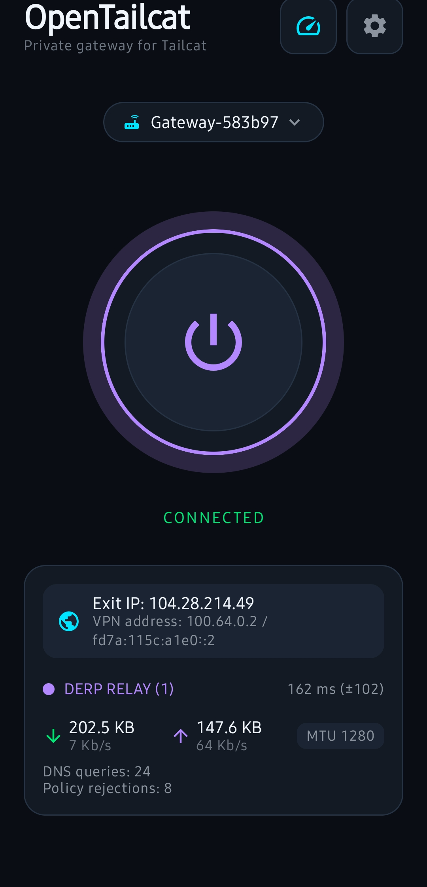
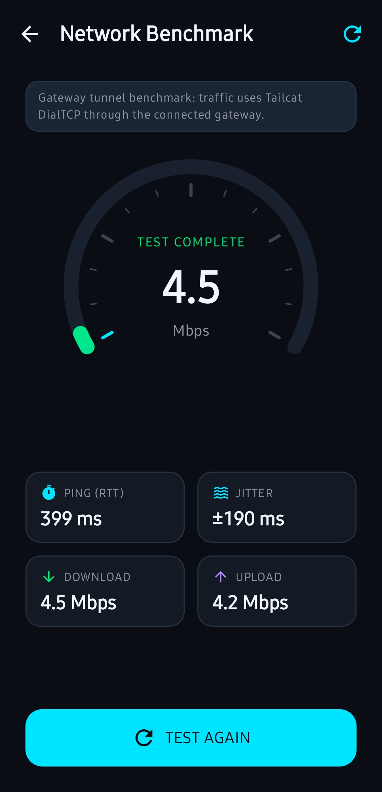

# OpenTailcat

**An Android VPN client that connects your phone straight to your own
[Tailcat](https://github.com/tailscale/tailcat) exit gateway.** You run the
gateway, paste its `tc…` token, and your traffic leaves through it. No account,
no subscription, and no control plane in the middle.

Independent community project. Not affiliated with Tailscale Inc.

<p align="center">
  
  &nbsp;
  
</p>

## What you need

- A Tailcat-compatible **exit gateway you control** (for example
  `tailcat serve exit-node`) and the `tc…` token it prints.
- An Android 8.0+ phone (arm64). Emulator builds use x86_64.

## What it does

- Sends the whole device through your gateway: TCP, UDP, and DNS over IPv4,
  and over IPv6 when the gateway has IPv6 connectivity.
- Keeps several gateways as profiles, each with its own DNS resolver, DNS
  policy, and MTU.
- Pairs by pasting a token, scanning a QR code with an installed scanner, or
  showing a saved profile's QR for another device.
- Excludes apps you choose from the tunnel (split tunneling).
- Shows live tunnel state: RTT, jitter, relay region, tunnel counters, and the
  public egress IP.
- Runs an on-demand speed test, through the gateway when connected and over
  device routes otherwise, labelling which path ran.
- Works with Android **Always-on VPN** and **Block connections without VPN**;
  disconnecting from the lock screen requires unlocking the phone.
- Has no accounts, ads, analytics, crash reporting, or camera permission. The
  GitHub build can update itself after checking the APK digest and signing
  certificate.

## How it works

```text
phone apps ─► Android VPN (TUN) ─► OpenTailcat engine ─► WireGuard/Magicsock ─► your gateway ─► Internet
```

1. The token carries the gateway's node and disco keys, an optional pre-shared
   key, and an optional relay (DERP) region.
2. The app opens a WireGuard-encrypted tunnel to that gateway, using Magicsock
   for NAT traversal and DERP relays as a fallback.
3. Android hands captured packets to the app's userspace TCP/IP stack, which
   proxies TCP and UDP flows and applies the profile's DNS and IPv6 policy.
4. The gateway decrypts the traffic and sends it to the Internet. Like any VPN
   exit, its operator can see that traffic.

There is no directory, account service, or OpenTailcat server anywhere in the
path.

## Install

1. Download the latest APK from the repository's **Releases** page on GitHub.
   Per-version details are in [docs/releases/](docs/releases/).
2. Pick the build for your device:
   - **Phone:** `OpenTailcat-<version>-arm64-v8a.apk`
   - **Emulator:** `OpenTailcat-<version>-x86_64.apk`
3. Optionally verify it against the matching `SHA256SUMS.txt` from the release.
4. Allow installs from your browser or file manager when Android asks.
5. Open the app, tap the gateway chip, choose **Pair another gateway**, and
   paste your token.
6. Recommended: enable **Always-on VPN** and **Block connections without VPN**
   in Android settings.

Releases are development-signed for now, so very old installs may need to be
uninstalled before upgrading. See [docs/signing.md](docs/signing.md).

## Privacy

OpenTailcat has no accounts, advertising, analytics, or crash reporting. Saved
gateways and tokens are encrypted with a key held by Android Keystore; backup
and device-to-device transfer are disabled for app data.

The app contacts only what it needs: your gateway and its relays, Cloudflare
`1.1.1.1` for the public-egress-IP card and the tunnel exit-IP audit,
`speed.cloudflare.com` when you start a speed test, and GitHub when you check
for updates. The F-Droid flavor has no updater. Apps you exclude from the
tunnel bypass it.

Full detail: [PRIVACY_POLICY.md](PRIVACY_POLICY.md).

## Project status

Development preview. The data plane runs and connects with a live token, but it
is still test-routing (`testRouting: true`) and is **not accepted for
privacy-sensitive traffic**:

- Physical dual-capture leak acceptance and roaming evidence are still open.
- Release builds use the development key; production signing and migration are
  future work.
- Reconnects briefly have no TUN, so keep Always-on VPN with lockdown on if that
  matters.
- Split-tunnel apps bypass the tunnel, and the gateway operator can see the
  traffic that exits through it.

The engineering contract, invariants, and remaining work live in
[AGENTS.md](AGENTS.md).

## Documentation

| Document | For | Answers |
| --- | --- | --- |
| [AGENTS.md](AGENTS.md) | contributors, LLMs | architecture, safety invariants, build, test, release |
| [docs/README.md](docs/README.md) | everyone | which document to read |
| [docs/releases/](docs/releases/) | users, maintainers | what changed in each version (historical record) |
| [docs/signing.md](docs/signing.md) | release managers | keys, certificate pins, migration |
| [PRIVACY_POLICY.md](PRIVACY_POLICY.md) | users | what is stored, sent, and visible |
| [SECURITY.md](SECURITY.md) | security reporters | how to report and the controls in place |
| [scripts/emulator/README.md](scripts/emulator/README.md) | testers | emulator and live-gateway test suites |
| [third_party/PROVENANCE.md](third_party/PROVENANCE.md) | maintainers | the pinned upstream Tailcat commit |

## Build from source

```bash
git submodule update --init
./gradlew assembleGithubDebug
```

Kotlin-only work builds against the checked-in native library; Go and the NDK
are needed only when changing `core-engine/`. Full commands, flavors, and the
AAR rebuild step are in [AGENTS.md](AGENTS.md#build-and-verify).

## License

Apache License 2.0 — see [LICENSE](LICENSE). OpenTailcat is an independent
project and is not affiliated with Tailscale Inc.
