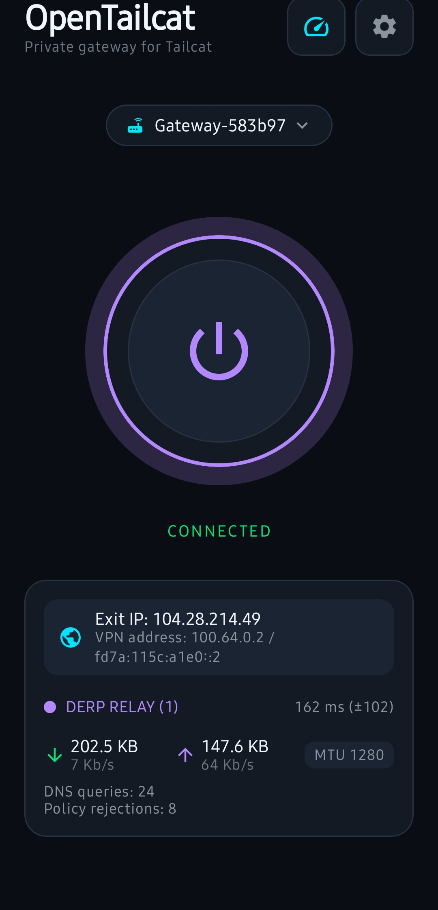
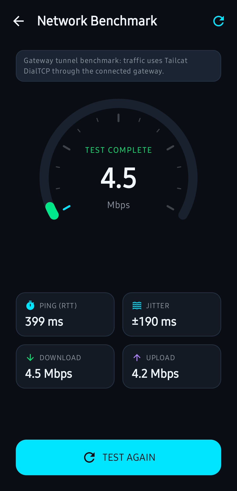

# OpenTailcat

Android client for Tailcat. Paste a `tc…` token and connect to **your** gateway — no control plane in the middle.

> Independent community project. Not affiliated with Tailscale Inc.

Development preview. Physical-device leak acceptance and production signing
remain pending. Reconnection removes the TUN between attempts; use Android's
Always-on VPN with Block connections without VPN to block traffic during those gaps.

## Screenshots

  
  &nbsp;
  

## What’s new in 1.5.4

- **Network changes**: underlay selection follows Android's default network and its
  best matching non-VPN network when available.
- **Token validation**: stricter Kotlin checks share generated regression
  fixtures with the native parser.
- **Build verification**: CI rebuilds the native AAR and verifies its module
  list, exported Java API, and source hash still match the committed artifact.
- **Maintenance**: one engineering guide and a pinned certificate for a future
  signing-key migration. The APK signing key has not rotated.

Full notes: [`docs/releases/1.5.4.md`](docs/releases/1.5.4.md). Older
releases: [`docs/releases/`](docs/releases/).

## Install

1. Grab the latest release from this repository's **Releases** page.
2. APKs:
   - **Phone:** `OpenTailcat-<version>-arm64-v8a.apk`
   - **Emulator (x86_64):** `OpenTailcat-<version>-x86_64.apk`
3. Install it (allow installs from your browser/file manager if asked).
4. Optional: enable **Always-on VPN** and **Block connections without VPN** for OpenTailcat — better if the tunnel drops. Connect still works without them.
5. Paste your `tc…` token and tap Connect.

Checksums are in `OpenTailcat-<version>-SHA256SUMS.txt` alongside each build.

## How it works

You run a Tailcat-compatible exit gateway. It gives you a short token. OpenTailcat uses that token to tunnel to your gateway.

## Notes

- Builds are development-signed unless you set `OPENTAILCAT_RELEASE_*`. Uninstall an older development install if Android blocks the upgrade.
- Release notes: [`docs/releases/`](docs/releases/). Engineering and test
  gates: [`AGENTS.md`](AGENTS.md). Signing status: [`docs/signing.md`](docs/signing.md).

## License

Apache License 2.0 — [LICENSE](LICENSE), [PRIVACY_POLICY.md](PRIVACY_POLICY.md).
