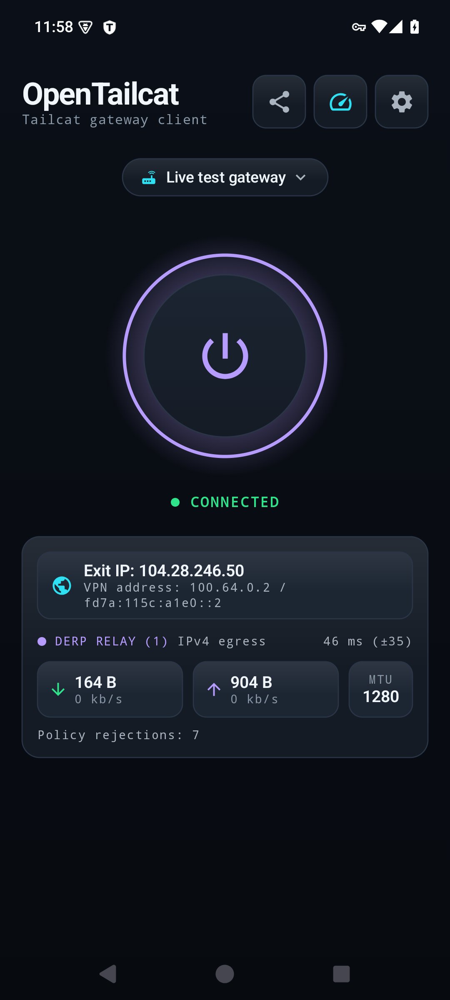
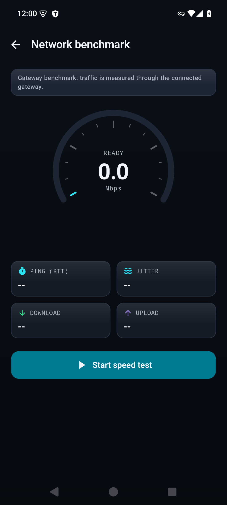

# OpenTailcat

Android app for [Tailcat](https://github.com/tailscale/tailcat) exit gateways. You can route your phone's traffic through a gateway you host (`tc…` token), or share your phone's connection as a gateway for another device. Everything runs peer-to-peer over WireGuard/Magicsock with DERP relay fallback, with no accounts or hosted control plane.

Independent community project, not affiliated with Tailscale Inc.

| Connect through your gateway | Share this phone | Speed test |
| --- | --- | --- |
|  |  |  |

## Requirements

- Android 8.0+ (arm64 for phones, x86_64 for emulators).
- For client mode: a Tailcat exit gateway (e.g. `tailcat serve exit-node`) and its `tc…` token, or a code from another phone running **Share this phone**.
- For exit-node mode: another device running OpenTailcat (or any Tailcat client) to connect with the generated code.

## Client mode

Paste a `tc…` token or import a QR image to pair a gateway. OpenTailcat establishes a WireGuard tunnel to the gateway, terminates captured TUN packets in a userspace TCP/IP stack (gVisor), and forwards IPv4/IPv6 TCP, UDP, and DNS over the tunnel.

What's included:

- Multiple saved gateway profiles, each with its own DNS resolver, DNS policy (profile resolver or forced resolver), and MTU (1280–1500).
- Token pairing via paste or on-device QR image import (uses Android's image picker and ZXing in memory, no camera permission), plus QR display for saved profiles.
- Per-app split tunneling (excluded apps bypass the VPN).
- Live stats: RTT, jitter, direct vs. DERP relay region, traffic counters, and tunnel exit IP.
- Built-in speed test (runs through `Client.DialTCP` when connected, or over normal device routes when disconnected, with the path labelled on screen).
- Android **Always-on VPN** and **Block connections without VPN** support. Disconnecting from the notification requires unlocking the phone first.
- Optional self-updater in the `github` flavor that verifies APK SHA-256 and signing certificate pins. The `fdroid` flavor removes the updater completely.

## Share this phone (exit node)

Tap the share button on the home screen to turn the phone into a temporary Tailcat exit gateway. It generates fresh session keys and a `tc…` code (shown as a QR and copyable), then forwards guests' TCP and UDP traffic out through your Wi-Fi or mobile data.

| Setup | Until I stop | Active share |
| --- | --- | --- |
|  |  |  |

1. Pick a duration: 15 min, 1 h, 4 h, 24 h, or **Until I stop**.
2. Choose admission mode: **Approve each device** (default) holds every new guest until you tap Approve. **Anyone with the code** skips approval and always requires a time limit.
3. Optionally specify your own DERP relay (hostname plus DERP/STUN ports) instead of auto-picking the nearest public region. The relay info is embedded in the session code so guests need no extra setup.
4. Tap **Start sharing**, let the guest scan or paste the code, and monitor active devices, open flows, and byte counts. Tap **Stop sharing** whenever you want to end the session and discard the keys.

Things to keep in mind when sharing:

- Guests leave through your internet connection, so sites see your IP address and traffic counts against your data plan and battery. Share only with people you trust.
- Guests are blocked from reaching loopback, private LAN (RFC 1918), CGNAT, link-local, and multicast addresses on your phone or local network.
- Sharing and the client VPN cannot run at the same time. Disconnect the VPN first, and turn off Android's "Block connections without VPN" while sharing or Android will block this app's outbound traffic.
- Sharing runs as a foreground service and does not survive Android killing the app. Stopping or process death discards the keys, so the old code stops working.
- Guests generate a fresh client key on each connection, so reconnecting requires a new approval.

## Install

1. Grab the latest APK from **Releases** (see [docs/releases/](docs/releases/) for changelogs and SHA-256 checksums):
   - Phones: `OpenTailcat-<version>-arm64-v8a.apk`
   - Emulators: `OpenTailcat-<version>-x86_64.apk`
2. Verify against `OpenTailcat-<version>-SHA256SUMS.txt` if you want, then install.
3. Open the app, tap the gateway selector, choose **Pair another gateway**, and paste or import your token.
4. For the client VPN, turning on **Always-on VPN** and **Block connections without VPN** in Android settings is recommended.

Pre-1.0/preview builds are signed with the development key; see [docs/signing.md](docs/signing.md) if Android refuses an upgrade from a very old install.

## Privacy

OpenTailcat has no accounts, ads, analytics, or crash reporting. Saved profiles and tokens are encrypted with AES-256-GCM using a key in Android Keystore, and Android backup / device transfer is disabled.

Network traffic the app initiates itself:

- Your gateway and DERP relays (including `https://tailcat.dev/derpmap.json` when using public relays).
- Cloudflare `1.1.1.1` (TLS-pinned) for the device IP readout and the in-tunnel exit-IP check.
- `speed.cloudflare.com` (TLS-pinned) when you run a speed test.
- GitHub Releases when you check for or download updates (`github` flavor only).

See [PRIVACY_POLICY.md](PRIVACY_POLICY.md) for full details on permissions, logging, and gateway/host visibility.

## Project status

OpenTailcat is a development preview (`testRouting: true`). It connects and passes traffic with a live gateway, but it is **not ready for privacy-sensitive traffic**:

- Physical dual-capture leak testing on ARM64 and real-device roaming/doze validation are still open.
- Release APKs currently use the development signing key.
- Reconnects briefly drop the TUN between attempts unless Android's Always-on lockdown ("Block connections without VPN") is enabled.
- Split-tunnel apps bypass the VPN, and the gateway operator can see decrypted exit traffic.
- **Share this phone** has been tested on an emulator host with a physical guest phone over mobile data, but long-session battery/heat behavior and physical-phone hosting haven't been measured yet. The host also cannot cryptographically verify which person is behind a pending device key, so only approve devices you expect.

See [AGENTS.md](AGENTS.md) for architecture, invariants, and the full list of open work.

## Build from source

```bash
git submodule update --init
./gradlew assembleGithubDebug
```

Kotlin changes build against the checked-in `libtailcat.aar` and don't need Go or the NDK. Full build, test, and AAR rebuild instructions are in [AGENTS.md](AGENTS.md#build-and-verify).

## Documentation

- [AGENTS.md](AGENTS.md): architecture, invariants, build/test/release, open work
- [docs/README.md](docs/README.md): full documentation index
- [docs/releases/](docs/releases/): release notes and checksums
- [docs/signing.md](docs/signing.md): signing keys and rotation notes
- [PRIVACY_POLICY.md](PRIVACY_POLICY.md): data storage, network requests, permissions
- [SECURITY.md](SECURITY.md): reporting issues and security controls
- [scripts/emulator/README.md](scripts/emulator/README.md): emulator test scripts
- [third_party/PROVENANCE.md](third_party/PROVENANCE.md): pinned upstream Tailcat commit

## License

Apache License 2.0 ([LICENSE](LICENSE)). OpenTailcat is an independent project and is not affiliated with Tailscale Inc.
